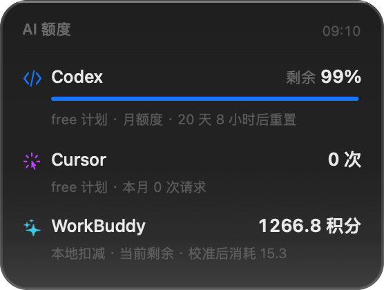

# AI 额度悬浮窗

> 一个常驻 macOS 桌面的小卡片，随时告诉你各个 AI 服务还剩多少额度。

<p align="center">
  
</p>

<p align="center">
  <a href="https://github.com/shadyyoung/ai-quota-hud/releases/latest"></a>
  <a href="https://github.com/shadyyoung/ai-quota-hud/actions"></a>
  
  <a href="LICENSE"></a>
</p>

原生 Swift + AppKit 编写，约 460 KB，不依赖 Electron 或任何第三方库。

## 特性

- **液态玻璃质感**：顶部冷光渐变、内壁高光描边、大圆角，跟随系统深浅色
- **平时隐形**：收成一条 10pt 细线（18% 透明度），鼠标靠近才展开成完整卡片
- **点击穿透**：鼠标不在卡片上时，点击、拖选、滚动全部穿透到下面的窗口
- **全局快捷键** `⌥⌘A`：任何应用里按一下，卡片展开 5 秒
- **开机自启** + 位置记忆
- **低额度告警**：低于阈值时数字变红，并可发系统通知
- **可扩展数据源**：新 AI 用一份 JSON 配置就能接，不用改代码

| 展开态 | 收起态 |
|---|---|
|  |  |

## 快速开始

### 方式一：直接下载（推荐）

去 [Releases](https://github.com/shadyyoung/ai-quota-hud/releases/latest) 下载 `AIQuotaHUD-v*-macOS.zip`，解压后把 `AIQuotaHUD.app` 拖进 `~/Applications`。

首次打开如果提示「无法验证开发者」，右键 → 打开。

### 方式二：从源码构建

```bash
git clone https://github.com/shadyyoung/ai-quota-hud.git
cd ai-quota-hud
./build.sh          # 编译
./install.sh        # 安装到 ~/Applications 并设置开机自启
```

需要 Xcode Command Line Tools（`xcode-select --install`）。

安装后：
- 平时不用管，卡片在屏幕右上角
- **鼠标移上去**展开
- **⌥⌘A** 强制展开 5 秒
- **右键**卡片：刷新 / 设置 / 手动校准 / 开机自启 / 退出

## 平台版本

| 平台 | 实现 | 下载 |
|---|---|---|
| **macOS** | 原生 Swift + AppKit（460 KB） | [AIQuotaHUD-v1.0.0-macOS.zip](https://github.com/shadyyoung/ai-quota-hud/releases/download/v1.0.0/AIQuotaHUD-v1.0.0-macOS.zip) |
| **Windows** | Electron（106 MB） | [AIQuotaHUD-v1.0.0-windows.zip](https://github.com/shadyyoung/ai-quota-hud/releases/download/v1.0.0/AIQuotaHUD-v1.0.0-windows.zip) |

Windows 版的界面与交互和 macOS 版对齐：透明置顶、点击穿透、悬停展开、托盘菜单、Ctrl+Alt+A 热键、开机自启。

> Windows 版和 macOS 版一样支持 Codex / Cursor / WorkBuddy 与自定义数据源。Cursor 和 WorkBuddy 的 SQLite 数据用纯 WASM 的 [sql.js](https://sql.js.org/) 读取，不需要原生编译。

## 支持哪些服务

| 服务 | 数据来源 | 状态 |
|---|---|---|
| **Codex / ChatGPT** | `chatgpt.com/backend-api/wham/usage`（走代理） | ✅ 实时 |
| **Cursor** | 本地登录态 → `api2.cursor.sh/auth/usage` | ✅ 实时 |
| **WorkBuddy** | 本地 `workbuddy.db` 消耗流水 + 积分锚点 | ✅ 近实时 |
| **DeepSeek API** | `api.deepseek.com/user/balance` | ✅ 需填 Key |
| **Gemini** | — | ❌ 账号验证 + 网络双重限制 |
| 任意其他 | `providers.json` 自定义 | 🔧 自己配 |

### 每个数字是怎么来的

**Codex**：读取 `~/.codex/auth.json` 的 token，请求官方额度接口。国内需要代理，app 会自动探测本机代理端口（7890/7891/1080…），**只对自己的网络请求生效，不修改系统代理**。代理不可用时自动回退到 `~/.codex/sessions` 里的快照。

**Cursor**：从本地 `state.vscdb` 取登录 token，调官方 `/auth/usage`。免费计划没有请求上限，所以显示「本月 N 次请求」。

**WorkBuddy**：腾讯云端额度没有公开接口，采用「锚点 + 本地扣减」——你填一次当前剩余积分，之后每次消耗自动扣减。本地 `session_usage` 表有完整的消耗流水。

## 自定义数据源

所有非内置服务都可以用一份 JSON 配置接入，放在：

```
~/.config/ai-quota-hud/providers.json
```

右键 → 设置 → 「编辑数据源配置」可直接打开。

### 示例：接入一个带 API Key 的服务

```json
{
  "version": 1,
  "providers": [
    {
      "id": "kimi",
      "name": "Kimi",
      "accent": "orange",
      "type": "http",
      "url": "https://api.moonshot.cn/v1/users/me/balance",
      "headers": { "Authorization": "Bearer ${key}" },
      "apiKeySetting": "kimi.apiKey",
      "remainingPath": "data.available_balance",
      "totalPath": "data.cash_balance",
      "display": "value",
      "unit": "¥"
    }
  ]
}
```

### 字段说明

| 字段 | 说明 |
|---|---|
| `id` | 唯一标识 |
| `name` | 显示名称 |
| `accent` | 颜色：`blue` / `purple` / `teal` / `orange` / `indigo` |
| `type` | `http`（默认）/ `command` / `manual` |
| `url` | 请求地址（http 类型） |
| `headers` | 请求头，`${key}` 会被替换成你填的 key |
| `apiKeySetting` | 存 API Key 的 UserDefaults 键（右键菜单里设置） |
| `remainingPath` | 剩余额度在 JSON 里的点路径，如 `data.available_balance` |
| `totalPath` | 总量路径（可选，有它才画进度条） |
| `percentPath` | 直接给百分比的路径（0-100 或 0-1） |
| `resetPath` | 重置时间路径（unix 秒 / 毫秒 / ISO 字符串） |
| `display` | `percent` 显示百分比，`value` 显示数值 |
| `unit` | 单位，如 `¥`、`积分`、`次` |
| `viaProxy` | 是否走代理（默认 true） |

### 示例：执行命令拿额度

```json
{
  "id": "myai",
  "name": "My AI",
  "type": "command",
  "command": "myai-cli quota --json",
  "remainingPath": "remaining",
  "totalPath": "total",
  "display": "percent",
  "accent": "indigo"
}
```

命令的 stdout 可以是纯数字，也可以是 JSON。

## 设置

右键 → **设置…**

- 平时透明度（5% – 50%）
- 刷新间隔（30 / 60 / 120 / 300 秒）
- 低额度告警阈值
- 代理地址（留空自动探测）
- 低额度系统通知
- 自动检查更新
- 开机自动启动

## 从源码构建

```bash
./build.sh
```

产物在 `build/AIQuotaHUD.app`。

只要 Xcode Command Line Tools，**不需要完整 Xcode**。

> 注意：这个项目**不能使用 SwiftUI**。当本机 SDK 由 Swift 6.3.2 构建而编译器是 6.3.3 时，`import SwiftUI` 会报 “SDK not supported by the compiler”。所以 UI 全部用 AppKit 手绘。

### 离屏渲染预览（无需屏幕权限）

```bash
./build/AIQuotaHUD.app/Contents/MacOS/AIQuotaHUD --snapshot ./preview.png
```

适合在 CI 或无法截屏的环境里检查 UI。

### 切换图标风格

```bash
build/icongen build/AppIcon.iconset bars     # 一叠额度条
build/icongen build/AppIcon.iconset funnel   # 漏斗汇聚
```

## 隐私

- 所有数据都在本机读取
- 唯一联网的是各家官方额度接口
- 代理只挂在 app 自己的 `URLSession` 上，**不改系统设置、不影响其他应用**
- 没有任何统计或上报

## 项目结构

```
Sources/
  Models.swift       数据模型
  Providers.swift    Codex / Cursor / WorkBuddy / DeepSeek 实现
  JsonProvider.swift 配置驱动的通用数据源
  Collector.swift    汇总 + 手动校准覆盖
  Calibration.swift  手动校准与积分锚点
  ProxyConfig.swift  本 app 私有代理
  AppSettings.swift  设置存取
  SettingsWindow.swift 设置窗口
  Notifier.swift     低额度通知
  Updater.swift      更新检查
  HUDView.swift      自绘卡片 UI（Liquid Glass）
  AppDelegate.swift  窗口、热键、菜单
  Snapshot.swift     离屏渲染
  IconGen.swift      图标生成
build.sh             编译 + 打包
install.sh           安装 + 开机自启
```

## 已知限制

1. **Codex 依赖代理**：直连 `chatgpt.com` 在国内不可用，代理挂了会退回本地快照。
2. **WorkBuddy 是估算值**：锚点 + 本地消耗扣减，赠送或重置积分后需要重新填一次。
3. **Cursor 免费计划没有百分比**：官方本身就没有请求上限。
4. **Gemini 暂不支持**：额度接口要求账号验证，且网络受限。

## License

[MIT](LICENSE)
