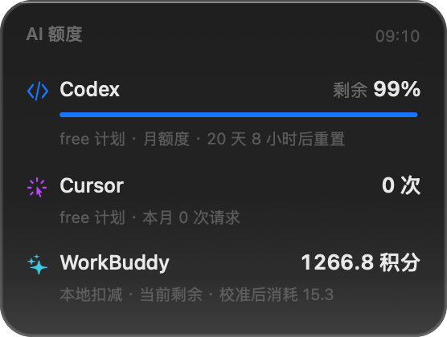

# AI Quota HUD

> A tiny always-on-desktop card for macOS that shows how much quota each AI service has left.

<p align="center">
  
</p>

Written in native Swift + AppKit. ~460 KB, no Electron, no third-party dependencies.

## Features

- **Liquid Glass look** — top light gradient, inner rim highlight, large corner radius, adapts to light/dark mode
- **Invisible by default** — collapses into a 10pt line at 18% opacity; expands when the cursor approaches
- **Click-through** — when the cursor is elsewhere, clicks/drags/scrolls pass straight through
- **Global hotkey** `⌥⌘A` — expands the card for 5 seconds from any app
- **Launch at login** + remembers its position
- **Low-quota alerts** — numbers turn red below a threshold, optional system notification
- **Pluggable data sources** — add a new AI with a JSON config, no code changes

| Expanded | Collapsed |
|---|---|
|  |  |

## Quick start

```bash
git clone https://github.com/OWNER/ai-quota-hud.git
cd ai-quota-hud
./build.sh          # build
./install.sh        # install to ~/Applications + launch at login
```

Requires Xcode Command Line Tools (`xcode-select --install`).

Usage:
- Leave it alone — the card sits in the top-right corner
- **Hover** to expand
- **⌥⌘A** to force-expand for 5 seconds
- **Right-click** the card: refresh / settings / manual calibration / launch at login / quit

## Supported services

| Service | Source | Status |
|---|---|---|
| **Codex / ChatGPT** | `chatgpt.com/backend-api/wham/usage` (via proxy) | ✅ live |
| **Cursor** | local token → `api2.cursor.sh/auth/usage` | ✅ live |
| **WorkBuddy** | local `workbuddy.db` usage stream + credit anchor | ✅ near-live |
| **DeepSeek API** | `api.deepseek.com/user/balance` | ✅ needs API key |
| **Gemini** | — | ❌ account verification + network restrictions |
| Anything else | `providers.json` | 🔧 configure yourself |

### Where each number comes from

**Codex** — reads the token in `~/.codex/auth.json` and calls the official quota endpoint. `chatgpt.com` is unreachable from mainland China, so the app auto-detects a local proxy port (7890/7891/1080…) and applies it **only to its own network requests — the system proxy is never touched**. Falls back to a cached snapshot in `~/.codex/sessions` when the proxy is down.

**Cursor** — reads the login token from the local `state.vscdb` and calls `/auth/usage`. The free plan has no request cap, so it shows "N requests this month".

**WorkBuddy** — Tencent exposes no public quota API, so it uses "anchor + local deduction": you enter the current remaining credits once, then each session's consumption is subtracted. The local `session_usage` table records every session's credit usage.

## Custom data sources

Any non-built-in service can be added with a JSON config at:

```
~/.config/ai-quota-hud/providers.json
```

Right-click → Settings → "Edit data source config" opens it.

### Example: a service with an API key

```json
{
  "version": 1,
  "providers": [
    {
      "id": "kimi",
      "name": "Kimi",
      "accent": "orange",
      "type": "http",
      "url": "https://api.moonshot.cn/v1/users/me/balance",
      "headers": { "Authorization": "Bearer ${key}" },
      "apiKeySetting": "kimi.apiKey",
      "remainingPath": "data.available_balance",
      "totalPath": "data.cash_balance",
      "display": "value",
      "unit": "¥"
    }
  ]
}
```

### Fields

| Field | Description |
|---|---|
| `id` | Unique identifier |
| `name` | Display name |
| `accent` | Color: `blue` / `purple` / `teal` / `orange` / `indigo` |
| `type` | `http` (default) / `command` / `manual` |
| `url` | Request URL (http type) |
| `headers` | Request headers; `${key}` is replaced with your stored key |
| `apiKeySetting` | UserDefaults key that stores the API key |
| `remainingPath` | Dot path to remaining quota, e.g. `data.available_balance` |
| `totalPath` | Dot path to total (optional — enables the progress bar) |
| `percentPath` | Dot path to a percentage (0-100 or 0-1) |
| `resetPath` | Dot path to reset time (unix seconds / ms / ISO string) |
| `display` | `percent` shows a percentage, `value` shows a number |
| `unit` | Unit label, e.g. `¥`, `credits` |
| `viaProxy` | Route through the proxy (default true) |

### Example: a command-based source

```json
{
  "id": "myai",
  "name": "My AI",
  "type": "command",
  "command": "myai-cli quota --json",
  "remainingPath": "remaining",
  "totalPath": "total",
  "display": "percent",
  "accent": "indigo"
}
```

The command's stdout can be a plain number or JSON.

## Settings

Right-click → **Settings…**

- Idle opacity (5% – 50%)
- Refresh interval (30 / 60 / 120 / 300 s)
- Low-quota threshold
- Proxy address (blank = auto-detect)
- System notifications for low quota
- Automatic update check
- Launch at login

## Build from source

```bash
./build.sh
```

Output: `build/AIQuotaHUD.app`.

Only Command Line Tools are required — **a full Xcode installation is not needed**.

> Note: this project **cannot use SwiftUI**. When the local SDK is built with Swift 6.3.2 while the compiler is 6.3.3, `import SwiftUI` fails with "SDK not supported by the compiler". All UI is hand-drawn with AppKit.

### Offscreen preview (no screen-recording permission needed)

```bash
./build/AIQuotaHUD.app/Contents/MacOS/AIQuotaHUD --snapshot ./preview.png
```

### Icon styles

```bash
build/icongen build/AppIcon.iconset bars     # stacked quota bars
build/icongen build/AppIcon.iconset funnel   # converging funnel
```

## Privacy

- Everything is read locally
- The only network calls go to each vendor's official quota endpoint
- The proxy is attached to the app's own `URLSession` only — **system settings and other apps are untouched**
- No telemetry

## Project layout

```
Sources/
  Models.swift         data model
  Providers.swift      Codex / Cursor / WorkBuddy / DeepSeek
  JsonProvider.swift   config-driven generic providers
  Collector.swift      aggregation + manual override
  Calibration.swift    manual calibration & credit anchor
  ProxyConfig.swift    app-private proxy
  AppSettings.swift    settings storage
  SettingsWindow.swift settings window
  Notifier.swift       low-quota notifications
  Updater.swift        update check
  HUDView.swift        hand-drawn Liquid Glass card
  AppDelegate.swift    window, hotkey, menus
  Snapshot.swift       offscreen rendering
  IconGen.swift        icon generator
build.sh               build + bundle
install.sh             install + launch-at-login
```

## Known limitations

1. **Codex needs a proxy** — `chatgpt.com` is not reachable directly from mainland China; without a proxy it falls back to a local snapshot.
2. **WorkBuddy is an estimate** — anchor plus local deduction; re-enter the number after credits are gifted or reset.
3. **Cursor free plan has no percentage** — the plan itself has no request cap.
4. **Gemini is not supported yet** — the quota endpoint requires account verification and the network is restricted.

## License

[MIT](LICENSE)
